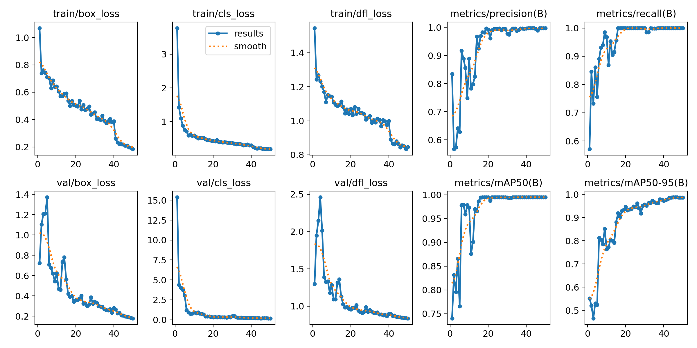
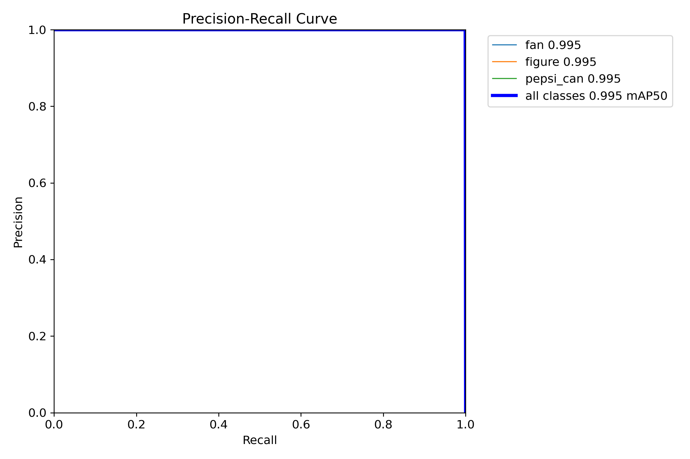

# YOLOv8 객체 감지 및 추적 (3개 클래스)

2024042080 김은솔

직접 촬영한 사진으로 YOLOv8을 학습시켜 3가지 물체를 감지하고, 영상에서 추적한 과제입니다.

## 1. 클래스
| 클래스 | 물체 | 선정 이유 |
|---|---|---|
| `pepsi_can` | 펩시 제로 캔 | 작은 원통형, 검정·파랑 계열 |
| `fan` | 탁상용 선풍기 | 큰 원형, 흰색 망 구조 |
| `figure` | 애니메이션 피규어 | 사람 형태, 청록색 |

※ 사전학습 모델(COCO 80개 클래스)에 없는 물체이고 각 물체간의 공통점이 없는 물체로 선정했습니다.

## 2. 데이터셋
- 직접 촬영한 이미지 **360장** (각 물건별로 120장, 흰 책상 배경 / 다양한 각도 / 손에 든 모습 포함)
- 라벨링: Roboflow (Auto Label 후 전체 수작업 검수)
- 분할: Train 252 / Valid 72 / Test 36 (70:20:10)
- 전처리: Auto-Orient, Resize 640×640
- 데이터셋 링크: [Roboflow 링크 : https://universe.roboflow.com/surcrious1s-workspace/machine-learning-yihbi]

## 3. 학습 환경 및 설정
- 환경: Google Colab (Tesla T4), Ultralytics 8.4.216
- 모델: YOLOv8n (`yolov8n.pt` 사전학습 가중치에서 전이학습)
- 설정: epochs 50, imgsz 640, batch 16
- 증강: YOLOv8 기본 증강 (Mosaic, 좌우 반전, HSV 등)

## 4. 성능
**Validation (72장)**
| 클래스 | Precision | Recall | mAP50 | mAP50-95 |
|---|---|---|---|---|
| all | 0.997 | 1.000 | 0.995 | 0.988 |
| fan | 0.997 | 1.000 | 0.995 | 0.974 |
| figure | 0.998 | 1.000 | 0.995 | 0.995 |
| pepsi_can | 0.996 | 1.000 | 0.995 | 0.995 |

**Test (36장)**
| 클래스 | Precision | Recall | mAP50 | mAP50-95 |
|---|---|---|---|---|
| all | 0.993 | 1.000 | 0.995 | 0.984 |
| fan | 0.988 | 1.000 | 0.995 | 0.963 |
| figure | 0.993 | 1.000 | 0.995 | 0.995 |
| pepsi_can | 0.996 | 1.000 | 0.995 | 0.995 |

| 학습 곡선 | Confusion Matrix | PR Curve |
|---|---|---|
|  |  |  |

## 5. 객체 추적 결과
- 추적기: ByteTrack (`model.track(persist=True)`)
- 학습에 사용하지 않은 새로 촬영한 영상, 5초 분량
- 각 객체의 중심점 궤적을 영상에 표시하고 `trajectory.csv`로 별도 저장

▶ [추적 결과 영상](yolo_assignment/tracking_result.mp4)

- 궤적을 추가해서 각 물체의 인식이 어떤 궤도를 따라 이동하였는지 도중에 인식이 이상하게 튀지 않았는지 확인


## 6. 파일 구조
```
YOLO/
├─ README.md
├─ requirements.txt
└─ yolo_assignment/
   ├─ YOLO.ipynb            # 학습·평가·추적 코드
   ├─ train/                # 학습 결과 (그래프, results.csv)
   │  └─ weights/best.pt    # 학습된 모델
   ├─ tracking_result.mp4   # 추적 결과 영상
   ├─ trajectory.csv        # 프레임별 객체 중심 좌표
   └─ trajectory.png        # 궤적 그래프
```

## 7. 과제 과정에서 경험한 내용
과제를 수행하기 위해서 어떻게 학습시켜야할지, 어떤 사진으로 학습을 시킬지, 어떤 요소가 학습이 안될지 생각해보면서 수업중에 듣는 것으로 와닿지 않는 부분들이 직접 과제를 통해 해보면서 체감이 많이 되었던 것 같습니다. 
다소 아쉬운 점이 있다면 콜라 학습 과정에서 다른 물체들에 비해서 크기가 작아서 최종 영상에서는 학습한 크기에 비해 작게 나와서 인식이 잘 되지 않게 나왔다는 점이 좀 아쉬우며, 학습과정에서 각도 및 다른 부분을 보여주는 것 뿐만 아니라 크기가 상이하게 나온 사진 또한 학습을 시켜서 결과를 보았다면 더 좋을 결과를 도출할 수 있었을 것 같습니다.